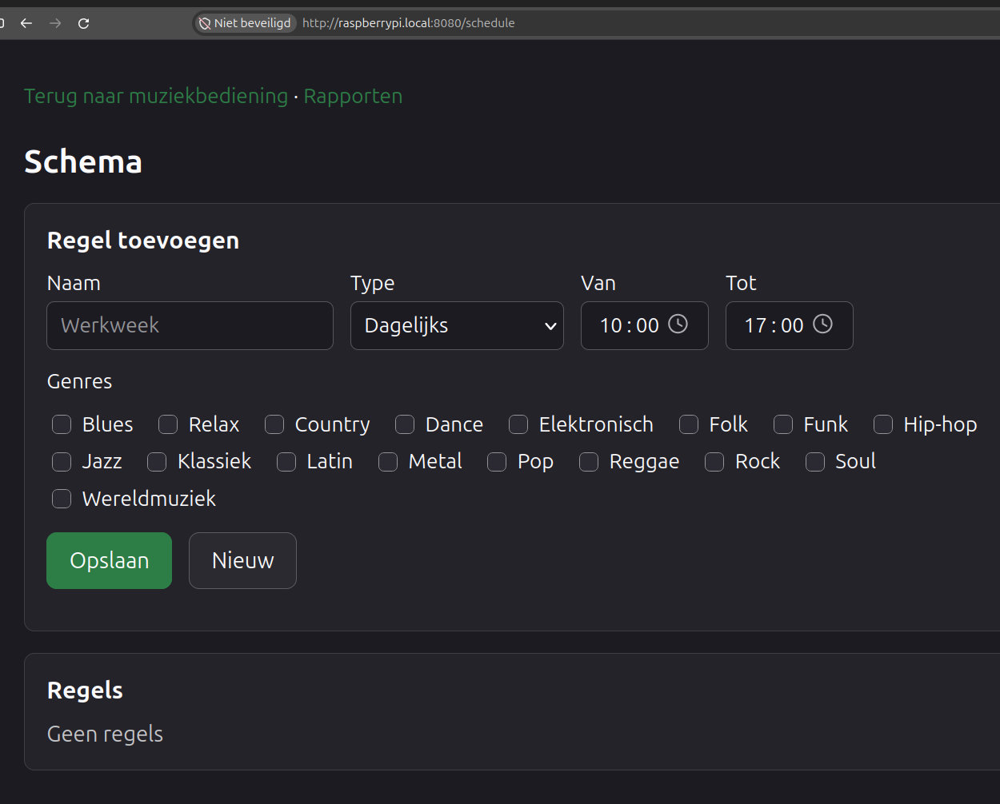
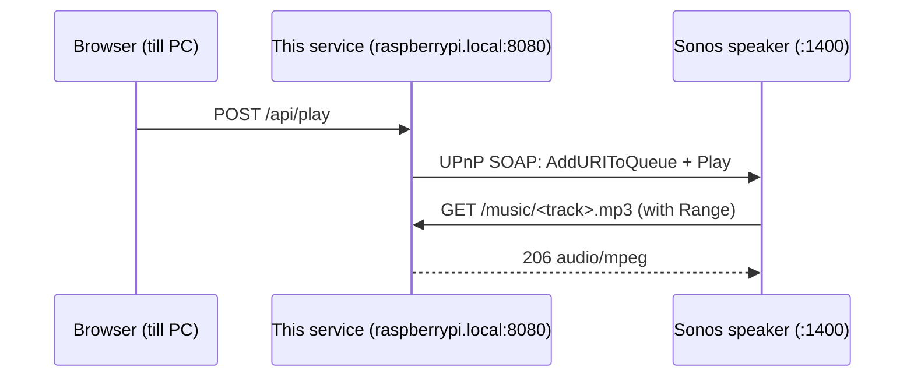

# Nierop Music Streaming Server

Music streaming for Sonos (or classic Audio Output).

The project is organized as a .NET solution with the application in `src/Streaming`
and unit tests in `tests/Streaming.Tests`.  The music collection under
`src/Streaming/wwwroot/music` is local runtime data and is intentionally excluded from
source control and published output.

Small ASP.NET Core minimal API that serves a local MP3 collection over HTTP to a Sonos
speaker, and controls that speaker directly over UPnP. Intended for a trusted local
network; the `/api` endpoints are protected by a shared token, the audio itself is served
without authentication because the speaker cannot send headers.

## Music sources and copyright

This application is not connected to or supplied with an external music catalogue or
streaming provider. It does not search for or download tracks from third-party services.
The operator supplies audio files by uploading them or copying them to the server, and the
service streams those local files to the configured player; it is not a source of music.
The operator is responsible for ensuring they have the necessary rights to store and play
every file.





## Why... the pain

Getting a Raspberry Pi to serve music to a Sonos speaker usually means stacking up
infrastructure: Samba or NFS to get the files onto the Pi, a media server such as Plex,
Jellyfin or a UPnP/DLNA daemon to expose them, snapd or Docker to install all of that, and a
mobile app to steer the result. Every one of those parts needs its own configuration,
updates and troubleshooting.

This service replaces that stack with a single self-contained binary. No media server, no
file share, no container runtime, no app to install. Drop the published output on the Pi,
enable one systemd unit, and open the page in any browser on the network. Uploading and
deleting tracks happens straight from that page, so the file share disappears too.

The Raspberry Pi is the primary deployment target, but the service is not Pi-specific. It
also runs on an Intel x64 laptop; other compatible Linux x64 computers, such as a NUC, are
likely to work but have not been formally tested. The published installer and release
instructions currently target Linux ARM64.

Because the speaker fetches the audio from the Pi over the local network, playback uses no
internet bandwidth at all and keeps working when the connection drops. That makes it a
practical fit for a restaurant, salon or shop that wants to play its own music over its own
wifi, without a streaming subscription and without the licensing and reliability questions
that come with a cloud service.

## Local debugging

In VS Code, start the `.NET Launch Streaming` configuration with F5. Once the server is
listening, VS Code opens the control page in the default browser at `http://localhost:8080`,
or at the configured `Streaming:Port`. The browser launch depends on the ASP.NET Core
`Microsoft.Hosting.Lifetime` information-level startup message being visible in the Debug
Console.

## Installation
The application is a single, standalone native binary compiled with Native AOT. Every
release ships a ready-to-run package for 64-bit ARM Linux (Raspberry Pi 3/4/5 running a
64-bit OS such as Raspberry Pi OS 64-bit).
At least **512 MB RAM** (512,000,000 bytes reported by the OS) and a running systemd
service manager are required. In one deployment measurement, the service used about
**167 MiB** of memory; actual use varies with workload, eg. using analog output instead of sonos over wifi, requires ffplay which may require an extra **100+ MiB** of memory.
The installer checks architecture, RAM, available disk space, the release's minimum glibc
version and native shared libraries before installing. Use a recent 64-bit OS.

The upload feature requires `ffmpeg` with the `libmp3lame` encoder on the server. The
installer installs the `ffmpeg` OS package with `apt-get` if needed. For Sonos playback, no
local audio output is required. For local ALSA playback, `ffplay` and a working ALSA audio
output such as an analog audio jack or USB audio adapter/DAC are also required.

### Install and upgrade

Run on the Raspberry Pi for both installation and upgrades using the latest published
GitHub release:

```bash
curl -fsSL https://github.com/egbertn/nieropstreamingserver/releases/latest/download/install-streaming.sh | sudo bash
sudo systemctl enable --now nierop-music
```

The installer attached to release `v1.0.1` still uses the former repository name and
fails with `Unexpected GitHub release URL`. Use a newer release instead.

The installer is attached to each new release. The former website download is no longer
automatically updated; use the GitHub release URL above.
The command runs downloaded code as root; inspect the script first if preferred.
The script downloads the latest stable GitHub release and verifies its SHA-256 checksum.
This checks download integrity, not an independent publisher signature.

Open **http://raspberrypi.local:8080** (or `http://<hostname>.local:8080` for another hostname).
Enter the API token printed by the installer. You can retrieve it later with:

```bash
sudo cat /etc/nierop-music/environment
```

The installer asks whether to use Sonos or local ALSA audio. For ALSA it lists playback
devices and playback-volume mixer controls on the chosen card; select the output and its
matching control. It stops before installing if no suitable hardware volume control is
available. It installs the application in
`/opt/streaming` and creates a dedicated, non-login `streaming` service account. It does
not start a new installation until you run the second command. On upgrades it stops the
running service before copying files and restarts it afterwards. Music, the database,
schedule, systemd overrides and `/etc/nierop-music/environment` are preserved; the audio
output selection updates `Streaming__Playback__UseSonos`. When Sonos is selected, the installer adds
`Streaming__Sonos__DiscoveryPort=1901` if it is not already set, preserving an existing
choice. An active service is restarted after the installer applies the audio settings.
The `.local` address requires mDNS on the Pi and client. If it does not resolve, use the
Pi's LAN IP in the browser and update `Streaming__PublicBaseUrl` in the environment file
to that same LAN address, then restart `nierop-music`. Do not expose this HTTP service to
the internet.

After installation, open `http://raspberrypi.local:8080` in a browser on the same network,
enter the generated API token (see [Access](#access)), and open the firewall ports (see
[Firewall](#firewall)). If the machine is not reachable as `raspberrypi.local`, override
`Streaming__PublicBaseUrl` in `/etc/nierop-music/environment`. For the USB-DAC
broadcast mode, also set up local ALSA audio (see
[USB-DAC broadcast mode](#usb-dac-broadcast-mode)).

## Professional installation

The software is free and open source (AGPL-3.0), and you are welcome to set it up
yourself using the instructions below. If you would rather not deal with Raspberry Pis,
systemd units and firewall rules, a paid installation service is available: a
pre-configured device delivered and installed on site, connected to your Sonos speakers
and your own music collection, with optional support and updates afterwards. This is
aimed at restaurants, salons and shops that want their own music over their own wifi
without a streaming subscription.

For pricing and availability, use the contact form at
[nieropcomputervision.com/contact](https://nieropcomputervision.com/contact).

## How it works



The audio goes straight from the service to the speaker. The browser only sends commands;
no sound passes through the till PC.

### Local audio output (ALSA)

Sonos is optional. In local broadcast mode, the service plays the playlist itself and sends
the audio through Linux's ALSA audio system to the selected output. Connect
powered speakers or an amplifier to the computer's analog audio jack (where available), or
use a USB audio adapter/DAC. The browser still only sends playback commands; audio comes
directly from the server's audio output. This mode does not contact or require a Sonos
speaker. See [USB-DAC broadcast mode](#usb-dac-broadcast-mode) for setup instructions.

## Endpoints

| Endpoint | Purpose |
|---|---|
| `GET /` | control page with Start/Pause/Stop/Next, volume, upload and track list |
| `GET /music/{path}` | the audio file itself, with range requests (seeking works) |
| `GET /api/tracks` | JSON list with path, title and absolute URL |
| `POST /api/tracks` | multipart upload of MP3, M4A, FLAC, WAV, OGG, MP4 or WMV files, with optional `invoice` and per-track `license:<original-file-name>` files |
| `DELETE /api/tracks/{path}` | delete a single file from the music folder |
| `GET /playlist.m3u` | M3U with absolute URLs |
| `GET /tracks` | plain HTML file listing |
| `GET /report` | choose either the collection report or the playback audit |
| `GET /report/music` | collection report page with PDF preview, download and email options |
| `GET /report/pdf` | PDF report containing all tracks, durations, metadata tags and copyright status |
| `POST /api/report/email` | send the generated PDF report via email (configured via `Smtp`) |
| `GET /report/audit/download` | ZIP download containing `speel-audit.json` |
| `POST /report/audit/email` | send the ZIP playback audit report by email |
| `GET /health` | status and number of tracks found |
| `GET /api/speakers` | discovered speakers (`?refresh=true` forces a new search) |
| `GET /api/state` | `PLAYING`, `PAUSED_PLAYBACK` or `STOPPED` |
| `POST /api/play?mode=all` | plays all tracks without the schedule (also the default when `mode` is omitted) |
| `POST /api/play?mode=schedule` | follows the genre schedule, waiting silently outside scheduled times |
| `POST /api/play/selection` | plays the supplied `{"paths":["relative/path.mp3"]}` without the schedule |
| `POST /api/pause`, `/api/stop`, `/api/next`, `/api/previous` | transport control |
| `POST /api/volume?level=0..100` | volume |

All control endpoints optionally accept `?speaker=<name or ip>`. Without that parameter the
first speaker found is used. Both play endpoints accept `?shuffle=true` for random order.

## Access

Everything under `/api` requires an `X-Api-Token` header matching `Streaming:ApiToken`. The
control page asks for the token once and keeps it in `localStorage`. Because the header is a
custom one, browsers send a CORS preflight for it, which also stops other websites from
firing requests at the service.

Release installations automatically generate a token in `/etc/nierop-music/environment`.
Edit that root-only file to change the token or public LAN URL and restart the service.
The environment file takes precedence over `Environment=` entries in systemd overrides.

Leave `Streaming:ApiToken` empty and the check is skipped entirely, which is convenient for
local development; a warning is logged at startup. Generate a token with
`openssl rand -base64 24` and set it through systemd so it stays out of git:

```bash
sudo systemctl edit --full nierop-music
```
```ini
[Service]
Environment=Streaming__ApiToken=<token>
```

`GET /music/*` stays open: the Sonos speaker fetches the audio itself and cannot
authenticate. Traffic is plain HTTP, so the token is readable to anyone who can capture
traffic on the network. That is a deliberate trade-off for a home network, in the same vein
as a router admin page over HTTP.

## Files on the Raspberry Pi

There is no `appsettings.json`; configuration is done with environment variables
(`Streaming__...`, `Smtp__...`) in `/etc/nierop-music/environment` or a systemd override.

| What | Location |
|---|---|
| Application | `/opt/streaming` |
| Music | `/opt/streaming/wwwroot/music` |
| Database, schedule | `/opt/streaming/data` |
| Secrets and settings | `/etc/nierop-music/environment` |
| Service unit | `/etc/systemd/system/nierop-music.service` |

The `data` directory holds only the database and schedule; music is never stored there.
Music and data are kept across upgrades and deployments.

## Music

MP3s (or m4a/flac/wav/ogg) live in `wwwroot/music` below the application directory
(`/opt/streaming/wwwroot/music` with the installer; `src/Streaming/wwwroot/music` in a source checkout), subfolders are allowed. Upload them from
the control page, or copy them straight onto the Pi with `rsync` or `scp`.

Uploads, including MP3s, are re-encoded as 192 kbit/s MP3 with FFmpeg's single-pass
`loudnorm` filter targeting -16 LUFS and -1.5 dBTP. Actual loudness can differ with short
or peak-limited material. MP4 and WMV uploads use the first audio stream; video is discarded.
Container and audio-stream metadata are copied where FFmpeg supports them. Files copied directly to the music
folder are not converted. Existing filenames are never overwritten; a numeric suffix is
added instead. The upload result reports unsupported, copyright-flagged and failed files
separately. Conversion temporarily uses disk space for both input and output and runs one
file at a time, with a 10-minute conversion timeout.

The dashboard displays ten tracks per page and filters by name and genre. Play selection
uses **all** matching results, not just the current page; with no search terms it selects
the whole collection. Choose all tracks without a schedule, the schedule, or the selection
before pressing Start. Shuffle is optional in each mode and the resulting queue repeats.

Schedule mode checks the rules and effective track genres every five seconds. It stops
outside active windows or when no tracks match, and resumes automatically when tracks
become eligible. An empty schedule therefore plays nothing. Pausing suspends schedule
playback; pressing Pause again resumes according to the current schedule. Stop cancels
schedule mode, as does starting another mode. Schedule monitoring runs in the server
process and must be started again after a server restart. Sonos playback cannot be
controlled by the schedule while the server is offline.

The collection is read from disk on every request, so new files are available immediately
without a restart. Starting playback rebuilds the speaker queue.

## Audit and evidence

SQLite is the audit source of truth. `MusicFile` has a stable auto-incrementing ID and a
unique SHA-256 checksum. The first index operation writes a `<audio-file>.checksum` cache
beside the audio file; on a renamed file the same checksum finds and updates the existing
catalogue record instead of creating a new identity. Existing tracks are indexed at startup.

The optional purchase evidence is stored once as a BLOB in `PurchaseEvidence` and can be
linked to multiple tracks. A license BLOB, its original filename and MIME type are stored on
the individual `MusicFile` record. The upload dialog first accepts an optional purchase
evidence file, then presents an optional license picker for each selected audio file.

`PlayAudit` references the music-file ID. While `Streaming:Playback:UseSonos` is true, a
background worker polls the active Sonos URI every 10 seconds. In local broadcast mode it
reads the application's own player state instead and never discovers or contacts Sonos. In
both modes a play is recorded only after the same track has played for at least 30 seconds.
`PlayAuditMonthly` is rebuilt when the worker starts and once on every new UTC day. The audit
report is a ZIP containing JSON with a UTC play-time list and monthly play count list per
track.

## USB-DAC broadcast mode

Set `Streaming:Playback:UseSonos` to `false` to make this service the player. The installer
configures `ffplay` to use the chosen ALSA playback device and the mixer on the same card.
The service unit grants the process the `audio` supplementary group for access to `/dev/snd`.

Install the player once on the Raspberry Pi and inspect the connected DAC:

```bash
sudo apt install ffmpeg alsa-utils
aplay -l
```

With the installer, select the DAC's playback device and its matching playback volume control.
For manual configuration, set the playback and mixer devices to the same ALSA card:

```ini
[Service]
Environment=Streaming__Playback__UseSonos=false
Environment=Streaming__Playback__AlsaPlaybackDevice=plughw:CARD=USB_DAC,DEV=0
Environment=Streaming__Playback__AlsaMixerDevice=hw:CARD=USB_DAC
Environment="Streaming__Playback__AlsaVolumeControl=Speaker,0"
```

`ffplay` is an external OS dependency and is not included in the Native AOT executable. Set
`Streaming:Playback:FfplayPath` when it is installed somewhere other than `ffplay` on `PATH`.
Replace `USB_DAC`, the device number and `Speaker,0` with values reported by `aplay -l`
and `amixer -D hw:CARD=USB_DAC scontents`. Select a control with `pvolume` capability
that controls the chosen output, and ensure it is unmuted. The volume slider changes
that hardware playback control, not the current track's software gain. Some cards have
multiple controls; sharing a card does not guarantee that each control affects every
output. The installer does not test the actual sound or change mixer levels, so test
playback and volume on the connected output after installation.

When no playback device is configured, `ffplay` retains its existing default audio
behavior and the mixer defaults to ALSA's `default` control device and `Master` control.
Set `Streaming__Playback__AlsaMixerPath` if `amixer` is not on the service's `PATH`.
Selecting an ALSA playback device forces SDL's ALSA driver and uses the selected PCM.

If `ffplay` plays through PulseAudio or PipeWire's PulseAudio compatibility server, set
`Streaming__Playback__AlsaMixerDevice=pulse` and use `Master` (check with
`amixer -D pulse scontrols`). This adjusts the PulseAudio server's default output, which
may differ from an explicitly selected stream output. The ALSA PulseAudio plugin and
access to the same user's PulseAudio server are required; a systemd service running as
another user may not have access. Restart the service after changing its configuration.

## CI and releases

Every branch push runs `.github/workflows/ci.yml` on the `streaming-build` ARM64
runner on Justin. It runs the installer and .NET tests and verifies a Native AOT publish.
It does not deploy to a Raspberry Pi or publish a release. The workflow can also be
started manually with `gh workflow run ci.yml --ref main`.

The separate quality workflow runs on pushes to `main` and reports coverage to SonarCloud.
Neither workflow needs a runner on the Raspberry Pi.

### Releases

Pushing a tag matching `v*` runs `.github/workflows/release.yml` on the same
`streaming-build` runner. It runs the tests, publishes the Native AOT executable and
attaches `streaming-<tag>-linux-arm64.tar.gz` — containing the binary,
the control page, systemd unit, internal `install.sh` helper, license and minimum glibc
version — plus a SHA-256 checksum and the public `install-streaming.sh` installer to a
GitHub release. The public installer invokes the helper automatically. To cut a release:

```bash
git tag v1.2.3
git push origin v1.2.3
```

Tag a commit that has passed CI. The release workflow checks out and tests the tagged
commit again; on success it publishes the release directly. A tag alone does not ensure
the commit passed the branch workflow. Protect release tags from being moved or deleted.
Installation and upgrades on the maintainer's Pi use the same release installer as customers.

The result is one executable of roughly 47 MB plus the control page.
FFmpeg is required for uploads, but no .NET runtime, snap or container is needed. Change
`RUNTIME` in the workflow to target a different architecture.

The release project is configured for Native AOT. Publishing produces a stripped native
executable instead of shipping the managed application assemblies. JSON responses use the
source-generated `StreamingJsonContext`; reflection-based JSON serialization is disabled.
The build runs natively on the ARM64 Justin runner; installation on a Raspberry Pi is a
separate, manual step.

## Quality checks

Installer checks run without root privileges or changes to local services:

```bash
bash tests/deploy/install-tests.sh
```

They cover hardware requirements (including the 512 MB boundary), checksum failures,
missing releases/libraries, disk space, initial installation, upgrades and health-check
failures. The release workflow runs these checks before building the binary.

The .NET conversion tests also require `ffmpeg`, `ffprobe`, `libmp3lame` and
`libvorbis` on the test machine.

Run the local checks with:

```bash
dotnet test Streaming.slnx --configuration Release /p:DebugType=portable /p:DebugSymbols=true /p:CollectCoverage=true /p:CoverletOutputFormat=opencover /p:CoverletOutput=TestResults/coverage.opencover.xml
```

The quality workflow runs on pushes to `main` using the self-hosted ARM64
`streaming-build` runner and its existing .NET SDK in `~/.dotnet`; it does not run
on pull requests. SonarScanner is installed in the runner's temporary directory
for each job. The workflow runs the same tests and sends OpenCover coverage to SonarCloud.
Configure the repository variables `SONAR_ORGANIZATION` and `SONAR_PROJECT_KEY`, plus the
`SONAR_TOKEN` secret, before enabling the quality gate.

```bash
journalctl -u nierop-music -f
```

## Configuration

| Key | Default | Meaning |
|---|---|---|
| `Streaming:Port` | 8080 | listening port, bound on all interfaces |
| `Streaming:PublicBaseUrl` | `http://raspberrypi.local:8080` | LAN URL that Sonos uses to fetch queued audio; must never be `localhost` |
| `Streaming:ApiToken` | empty | shared secret for `/api`; empty disables the check |
| `ConnectionStrings:sqlite` | `data/streaming.db` | SQLite catalogue and audit database; relative paths are resolved against the application directory |
| `Streaming:Playback:UseSonos` | `true` | `true` controls Sonos; `false` plays locally through `ffplay` and audits as `Broadcast` |
| `Streaming:Playback:FfplayPath` | `ffplay` | command or absolute path for the local broadcast audio player |
| `Streaming:Playback:AlsaPlaybackDevice` | unset | selected ALSA PCM device for `ffplay`; when unset, the player retains its default audio behavior |
| `Streaming:Playback:AlsaMixerDevice` | `default` | ALSA control device for the playback volume |
| `Streaming:Playback:AlsaVolumeControl` | `Master` | ALSA simple mixer control, optionally with its index (for example `Speaker,0`) |
| `Streaming:Playback:AlsaMixerPath` | `amixer` | command or absolute path for the ALSA mixer utility |
| `Streaming:Sonos:Addresses` | empty | JSON array or comma-separated speaker IPs; skips SSDP when a configured speaker responds |
| `Streaming:Sonos:DiscoveryPort` | 0 (installer: 1901) | fixed UDP source port for SSDP; set it when you need to open a specific firewall port |
| `Smtp:Host` | empty | SMTP server used for emailing reports; email endpoints fail when it is not configured |
| `Smtp:Port` | 587 | SMTP server port |
| `Smtp:Username` | empty | optional SMTP username |
| `Smtp:Password` | empty | optional SMTP password |
| `Smtp:UseSsl` | `false` | use TLS; port 465 uses implicit TLS, other ports use STARTTLS |
| `Smtp:From` | `music-report@local` | sender email address for reports |
| `Smtp:FromName` | `Sonos Muziek Server` | sender display name for reports |

Override these through systemd using double underscores:

```bash
sudo systemctl edit nierop-music
```
```ini
[Service]
Environment=Streaming__Sonos__Addresses=192.168.1.211
Environment=Streaming__Sonos__DiscoveryPort=1901
Environment=ConnectionStrings__sqlite=data/streaming.db
Environment=Smtp__Host=smtp.example.com
Environment=Smtp__Username=reports@example.com
Environment=Smtp__Password=<password>
```

The Sonos HTTP client logs warnings and errors by default, rather than logging
each periodic status request. To temporarily include the HTTP request details,
set the following systemd override and restart the service:

```ini
[Service]
Environment=Logging__LogLevel__System.Net.Http.HttpClient.SonosService=Trace
```

These request messages are emitted at `Information` level by .NET; the override
also enables its more detailed trace messages. Remove the override and restart
the service to return to the quieter default. There is no `appsettings.json`; all configuration comes from environment variables. An explicitly configured level for this category
continues to take precedence over the default.

## Firewall

Two things need to be open on the Pi:

```bash
sudo ufw allow from 192.168.1.0/24 to any port 8080 proto tcp   # speaker fetches audio
sudo ufw allow from 192.168.1.0/24 to any port 1901 proto udp   # SSDP replies
```

The UDP rule must match `Streaming:Sonos:DiscoveryPort` (1901 by default in the
installer). A value of 0 uses a dynamically assigned port, so opening 1901 alone
will not help. SSDP requests go to multicast address `239.255.255.250:1900`, but
unicast replies return to the service's source port, not necessarily 1900.
If outgoing traffic is restricted, also allow UDP to `239.255.255.250:1900`
and TCP to the speakers on port 1400.

The UDP rule is unnecessary when a speaker configured in `Streaming:Sonos:Addresses`
responds over HTTP on port 1400.

## Troubleshooting

**Player does nothing, play blinks.** Check that you are using a playable URL. `/` returns
HTML; players need `/playlist.m3u` or `/music/<file>.mp3`.

**"Geen speaker gevonden".** This does not necessarily mean the firewall is blocking
UDP 1900. Check the local search port in the SSDP log and match the incoming UDP rule
to that port. Multicast may also be blocked by wifi client isolation, a VLAN boundary,
or routed over the wrong interface. Inspect traffic during discovery with
`sudo tcpdump -ni any 'udp port 1900 or udp port 1901'`.
For a configured speaker, test HTTP directly with
`curl --fail --max-time 5 http://192.168.1.211:1400/xml/device_description.xml`.
Find speaker IPs with `sudo nmap -p 1400 --open 192.168.1.0/24`.

**Every API call returns 401.** The token is wrong or missing. Clear it in the browser with
`localStorage.removeItem('apiToken')` and reload, or check `Streaming__ApiToken` on the Pi.

**Seeing requests.** Kestrel only logs warnings by default. Enable temporarily:

```ini
[Service]
Environment=Logging__LogLevel__Microsoft.AspNetCore=Information
```

Or watch at packet level: `sudo tcpdump -i any -n 'tcp port 8080'`.

**Checking the stream without a speaker.** Open the MP3 URL in VLC, or:

```bash
curl -sI http://<host>:8080/music/<file>.mp3
curl -s -o /dev/null -w '%{http_code}\n' -H 'Range: bytes=0-1023' http://<host>:8080/music/<file>.mp3
```

Expect `200` with `Content-Type: audio/mpeg` and `Accept-Ranges: bytes`, and `206` on the
range request.

## License

This project is licensed under the [GNU Affero General Public License v3.0](LICENSE)
(AGPL-3.0-or-later). In short: you may use, modify and redistribute it freely, but if
you distribute it or offer it as a network service, you must make your source code —
including your modifications — available under the same license. For commercial
licensing outside the AGPL terms, contact the author.
