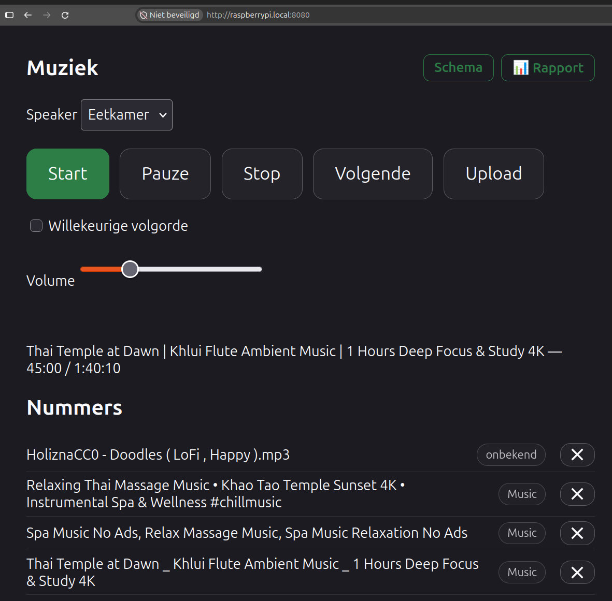
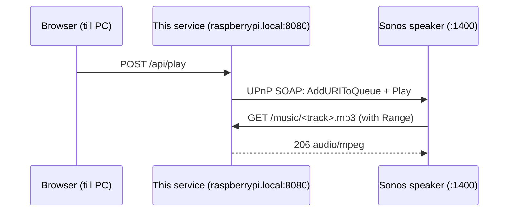

# Music streaming for Sonos

The project is organized as a .NET solution with the application in `src/Streaming`
and unit tests in `tests/Streaming.Tests`. The music collection under
`src/Streaming/wwwroot/music` is local runtime data and is intentionally excluded from
source control and published output.

Small ASP.NET Core minimal API that serves a local MP3 collection over HTTP to a Sonos
speaker, and controls that speaker directly over UPnP. Intended for a trusted local
network; the `/api` endpoints are protected by a shared token, the audio itself is served
without authentication because the speaker cannot send headers.



## Why

Getting a Raspberry Pi to serve music to a Sonos speaker usually means stacking up
infrastructure: Samba or NFS to get the files onto the Pi, a media server such as Plex,
Jellyfin or a UPnP/DLNA daemon to expose them, snapd or Docker to install all of that, and a
mobile app to steer the result. Every one of those parts needs its own configuration,
updates and troubleshooting.

This service replaces that stack with a single self-contained binary. No media server, no
file share, no container runtime, no app to install. Drop the published output on the Pi,
enable one systemd unit, and open the page in any browser on the network. Uploading and
deleting tracks happens straight from that page, so the file share disappears too.

Because the speaker fetches the audio from the Pi over the local network, playback uses no
internet bandwidth at all and keeps working when the connection drops. That makes it a
practical fit for a restaurant, salon or shop that wants to play its own music over its own
wifi, without a streaming subscription and without the licensing and reliability questions
that come with a cloud service.

## How it works



The audio goes straight from the service to the speaker. The browser only sends commands;
no sound passes through the till PC.

## Endpoints

| Endpoint | Purpose |
|---|---|
| `GET /` | control page with Start/Pause/Stop/Next, volume, upload and track list |
| `GET /music/{path}` | the audio file itself, with range requests (seeking works) |
| `GET /api/tracks` | JSON list with path, title and absolute URL |
| `POST /api/tracks` | multipart upload of one or more `audio/*` files, with optional `invoice` and per-track `license:<original-file-name>` files |
| `DELETE /api/tracks/{path}` | delete a single file from the music folder |
| `GET /playlist.m3u` | M3U with absolute URLs |
| `GET /tracks` | plain HTML file listing |
| `GET /report` | choose either the collection report or the playback audit |
| `GET /report/music` | collection report page with PDF preview, download and email options |
| `GET /report/pdf` | PDF report containing all tracks, durations, metadata tags and copyright status |
| `POST /api/report/email` | send the generated PDF report via email (configured via `Streaming:Smtp`) |
| `GET /report/audit/download` | ZIP download containing `speel-audit.json` |
| `POST /report/audit/email` | send the ZIP playback audit report by email |
| `GET /health` | status and number of tracks found |
| `GET /api/speakers` | discovered speakers (`?refresh=true` forces a new search) |
| `GET /api/state` | `PLAYING`, `PAUSED_PLAYBACK` or `STOPPED` |
| `POST /api/play` | queues every file on the server and starts. `?shuffle=true` for random order |
| `POST /api/pause`, `/api/stop`, `/api/next`, `/api/previous` | transport control |
| `POST /api/volume?level=0..100` | volume |

All control endpoints optionally accept `?speaker=<name or ip>`. Without that parameter the
first speaker found is used.

## Access

Everything under `/api` requires an `X-Api-Token` header matching `Streaming:ApiToken`. The
control page asks for the token once and keeps it in `localStorage`. Because the header is a
custom one, browsers send a CORS preflight for it, which also stops other websites from
firing requests at the service.

Leave `Streaming:ApiToken` empty and the check is skipped entirely, which is convenient for
local development; a warning is logged at startup. Generate a token with
`openssl rand -base64 24` and set it through systemd so it stays out of git:

```bash
sudo systemctl edit kestrel-music
```
```ini
[Service]
Environment=Streaming__ApiToken=<token>
```

`GET /music/*` stays open: the Sonos speaker fetches the audio itself and cannot
authenticate. Traffic is plain HTTP, so the token is readable to anyone who can capture
traffic on the network. That is a deliberate trade-off for a home network, in the same vein
as a router admin page over HTTP.

## Music

MP3s (or m4a/flac/wav/ogg) live in `src/Streaming/wwwroot/music`, subfolders are allowed. Upload them from
the control page, or copy them straight onto the Pi with `rsync` or `scp`.

The collection is read from disk on every request, so new files are available immediately
without a restart. The files on the server together form the playlist; on `POST /api/play`
the speaker queue is rebuilt from them and set to repeat, so the music keeps going.

## Audit and evidence

SQLite is the audit source of truth. `MusicFile` has a stable auto-incrementing ID and a
unique SHA-256 checksum. The first index operation writes a `<audio-file>.checksum` cache
beside the audio file; on a renamed file the same checksum finds and updates the existing
catalogue record instead of creating a new identity. Existing tracks are indexed at startup.

The optional purchase evidence is stored once as a BLOB in `PurchaseEvidence` and can be
linked to multiple tracks. A license BLOB, its original filename and MIME type are stored on
the individual `MusicFile` record. The upload dialog first accepts an optional purchase
evidence file, then presents an optional license picker for each selected audio file.

`PlayAudit` references the music-file ID. While `Streaming:Playback:UseSonos` is true, a
background worker polls the active Sonos URI every 10 seconds. In local broadcast mode it
reads the application's own player state instead and never discovers or contacts Sonos. In
both modes a play is recorded only after the same track has played for at least 30 seconds.
`PlayAuditMonthly` is rebuilt when the worker starts and once on every new UTC day. The audit
report is a ZIP containing JSON with a UTC play-time list and monthly play count list per
track.

## USB-DAC broadcast mode

Set `Streaming:Playback:UseSonos` to `false` to make this service the player. It starts
`ffplay` for the local playlist and sends audio to Linux's default ALSA audio device. The
USB-DAC should therefore be selected as the Pi's default output; the service unit grants the
process the `audio` supplementary group for access to `/dev/snd`.

Install the player once on the Raspberry Pi and inspect the connected DAC:

```bash
sudo apt install ffmpeg alsa-utils
aplay -l
```

Use the system's audio settings or an ALSA configuration to make the listed USB DAC the
default output, then configure the service:

```ini
[Service]
Environment=Streaming__Playback__UseSonos=false
```

`ffplay` is an external OS dependency and is not included in the Native AOT executable. Set
`Streaming:Playback:FfplayPath` when it is installed somewhere other than `ffplay` on `PATH`.

## Deploying

Every push to `main` runs `.github/workflows/deploy.yml`. The deployment uses two
repository-scoped ARM64 runners:

| Runner | Label | Directory | Responsibility |
|---|---|---|---|
| `justin-streaming` | `streaming-build` | `/home/moeder/actions-runner-streaming` on Justin | test and publish Native AOT |
| `raspberrypi-streaming` | `streaming-prod` | `/home/moeder/actions-runner-streaming` on the Pi | activate, restart, health check and rollback |

These installations and their systemd services are separate from the LinkATap runners.
The build is copied to `/home/moeder/apps/music.staging`; production remains in
`/home/moeder/apps/music`. Deployment excludes `wwwroot/music`, so the collection is not
deleted or copied into rollback snapshots.

The repository variable `DEPLOY_TARGET` contains the SSH target used by the Justin runner.
To start the same workflow manually from a development machine with an authenticated
GitHub CLI:

```bash
./publish.sh
REF=main ./publish.sh
```

`publish.sh` only dispatches GitHub Actions; it no longer cross-compiles or deploys from the
x64 development laptop. The service unit remains managed independently on the Pi.

The result is one executable of roughly 47 MB plus `appsettings.json` and the control page.
Nothing else has to be installed on the Pi: no .NET runtime, no snap, no container. Change
`RUNTIME` in the workflow to target a different architecture.

The release project is configured for Native AOT. Publishing produces a stripped native
executable instead of shipping the managed application assemblies. JSON responses use the
source-generated `StreamingJsonContext`; reflection-based JSON serialization is disabled.
The build runs natively on the ARM64 Justin runner and deploys the resulting executable to
the ARM64 Raspberry Pi.

## Quality checks

Run the local checks with:

```bash
dotnet test Streaming.slnx --collect:"XPlat Code Coverage;Format=opencover"
```

The GitHub Actions workflow runs the same tests and sends OpenCover coverage to SonarCloud.
Configure the repository variables `SONAR_ORGANIZATION` and `SONAR_PROJECT_KEY`, plus the
`SONAR_TOKEN` secret, before enabling the quality gate.

```bash
journalctl -u kestrel-music -f
```

## Configuration

| Key | Default | Meaning |
|---|---|---|
| `Streaming:Port` | 8080 | listening port, bound on all interfaces |
| `Streaming:PublicBaseUrl` | `http://raspberrypi.local:8080` | LAN URL that Sonos uses to fetch queued audio; must never be `localhost` |
| `Streaming:ApiToken` | empty | shared secret for `/api`; empty disables the check |
| `Streaming:DatabasePath` | `data/streaming.db` | SQLite catalogue and audit database, relative to the application directory when not absolute |
| `Streaming:Playback:UseSonos` | `true` | `true` controls Sonos; `false` plays locally via `ffplay` to the default USB-DAC/ALSA output and audits as `Broadcast` |
| `Streaming:Playback:FfplayPath` | `ffplay` | command or absolute path for the local broadcast audio player |
| `Streaming:Sonos:Addresses` | empty | comma-separated speaker IPs; skips SSDP |
| `Streaming:Sonos:DiscoveryPort` | 1901 | fixed UDP source port for SSDP, so you can open it in the firewall |

Override these through systemd using double underscores:

```bash
sudo systemctl edit kestrel-music
```
```ini
[Service]
Environment=Streaming__Sonos__Addresses=192.168.1.211
```

## Firewall

Two things need to be open on the Pi:

```bash
sudo ufw allow from 192.168.1.0/24 to any port 8080 proto tcp   # speaker fetches audio
sudo ufw allow from 192.168.1.0/24 to any port 1901 proto udp   # SSDP replies
```

The UDP rule is unnecessary if you fill in `Streaming:Sonos:Addresses`.

## Troubleshooting

**Player does nothing, play blinks.** Check that you are using a playable URL. `/` returns
HTML; players need `/playlist.m3u` or `/music/<file>.mp3`.

**"Geen speaker gevonden".** SSDP replies are blocked by the firewall. Open UDP 1901 or fill
in the speaker address. Find the IP with `sudo nmap -p 1400 --open 192.168.1.0/24`.

**Every API call returns 401.** The token is wrong or missing. Clear it in the browser with
`localStorage.removeItem('apiToken')` and reload, or check `Streaming__ApiToken` on the Pi.

**Seeing requests.** Kestrel only logs warnings by default. Enable temporarily:

```ini
[Service]
Environment=Logging__LogLevel__Microsoft.AspNetCore=Information
```

Or watch at packet level: `sudo tcpdump -i any -n 'tcp port 8080'`.

**Checking the stream without a speaker.** Open the MP3 URL in VLC, or:

```bash
curl -sI http://<host>:8080/music/<file>.mp3
curl -s -o /dev/null -w '%{http_code}\n' -H 'Range: bytes=0-1023' http://<host>:8080/music/<file>.mp3
```

Expect `200` with `Content-Type: audio/mpeg` and `Accept-Ranges: bytes`, and `206` on the
range request.
